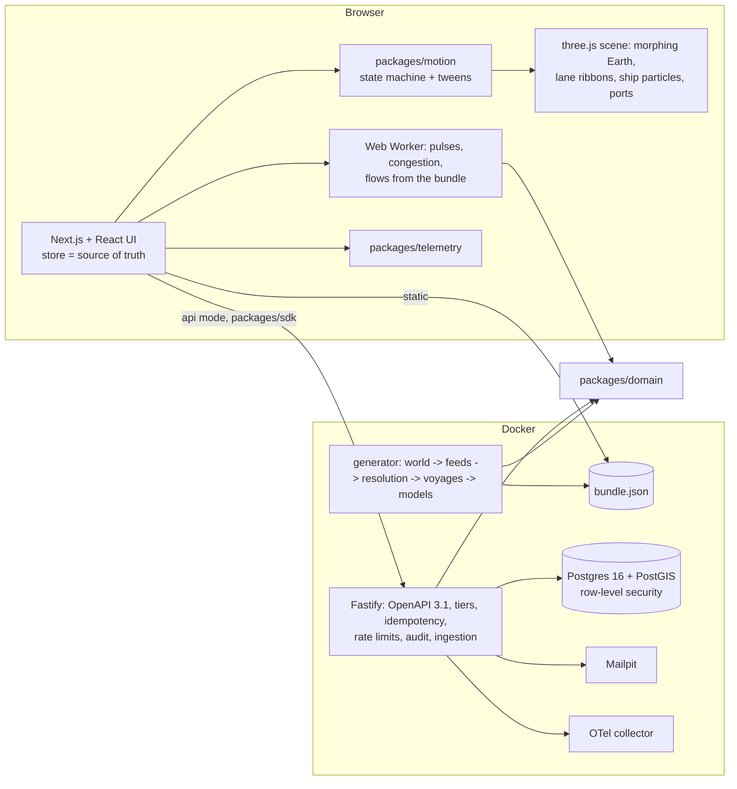

# PULSE: global economic activity, read from the sea

A live-style world map of trade where the public site is the product. Every ship at sea is a particle on its route for the
day on screen, every lane is a ribbon as wide as its last 30 days of cargo, and ports pulse when ships wait. Behind the map
are three pieces:

- a pipeline that rebuilds 45,758 voyages from two noisy feeds (vessel tracking and port authorities) by entity resolution;
- port congestion scored from dwell-time distributions;
- a regional "pulse" index (a dynamic factor model with a Kalman filter) that nowcasts a monthly official indicator published
  45 days after each month ends.

You can rewind to the synthetic shock and watch the East Asia pulse fall **77 days before** the official figure showed it.

Built from blueprint 04 of the *Motion-First Interactive Product Engineering Build Book (Volume V)* as a **vertical slice**:
the demo scenario is built end to end on the book's stack. The rest is listed under [Not built, and why](#not-built-and-why).

**Everything is synthetic. Ports sit at real coordinates (public geography), but every vessel, voyage, cargo, activity series,
official figure, shock and outage is generated by this repository with a hidden true process.** The models never see the truth;
it is used only to score them (the "Show truth" toggle draws it on the charts).

- Live sandbox (static, runs in your browser): https://mrrishit909.github.io/projects/pulse-economic-activity/demo/
- 2 min 11 s captioned recording: [`docs/video/demo.mp4`](docs/video/demo.mp4)
- Case study: https://mrrishit909.github.io/projects/pulse-economic-activity/

## Run it

```bash
docker compose up --build -d --wait     # web :8461, API :8460, PostGIS :55460, mail sink :8462, OTel collector, generator
make test                               # 30 unit + API tests in Docker against a throwaway PostGIS (about 45 s)
make e2e                                # 9 Playwright journeys against the static export (needs Google Chrome)
make load-test                          # reads + ingestion against an API started with RATE_LIMIT=1000000 PORT=8463
make seed | make reset | make record    # regenerate / wipe and reseed / re-record the demo video
```

Open http://localhost:8461. It is the same site as the public sandbox, but built to call the API. Alerts saved there arrive as
e-mail at http://localhost:8462. Demo tokens (local only):

- `meridian-analyst-demo`: operator at a macro fund (Institutional plan)
- `meridian-viewer-demo`: read-only
- `harbor-ops-demo`: operator in a second tenant, a supply-chain team (Pro plan), used for isolation tests

Anonymous calls get the free tier, with data 30 days behind.

## The demo, step by step (blueprint section 17)

1. **Live-style world map.** Four scroll chapters run over the map. First, all 6 commodities on 52 lanes between 34 ports.
   Then crude oil alone. Then the camera dives to East Asia at the Ningbo berth outage. Last, the globe unrolls into the flat
   map: it is one mesh with a morph uniform, so ports and routes stay in place while it changes.
2. **Crude oil flows.** Choosing crude recolours the map and decomposes the 30-day flow by route. On 17 March 2026 it is
   2.84 Mt/day, and Ras Tanura → Ningbo is the largest route at 19%. Each figure carries a confidence: cargo is estimated
   from draught (calibrated on customs declarations), so tonnage is shown with a 90% interval. A 14-day forecast comes with an
   interval measured in backtests.
3. **A congested port.** At Ningbo-Zhoushan, 70% of discharge berths go out of service from 23 February to 23 March 2026.
   Ships arriving in the week to 17 March wait a median **6.4 days against 1.6** in the 90 days before, a congestion score of
   **z = 33.5**. Ports pulse at a rate set by their score (always under 1 Hz). The inspector compares the last 14 days of dwell
   times with the 90 days before.
4. **Rewind to the shock.** Playback runs at −30, −7, +7 or +30 days a second. "Replay the East Asia slump" rewinds three
   weeks before the alarm and plays at 7 days a second.
5. **The pulse reacts before the lagging indicator.** The model is fitted only on data from before the shock and then filtered
   day by day. It flagged East Asia on **27 Feb 2026**, when the upper edge of its 80% band fell more than one standard
   deviation below its previous 90-day mean. The official indicator first showed the drop when the March figure was published
   on **15 May 2026**: **77 days later**. At the end of March the nowcast for March was 83.7 (80%: 82.3–85.1). The published
   figure, 82.1, came out six weeks later; the last published value on that day (January) was 93.1. Each day of the index
   splits exactly into contributions from power demand, road freight, cargo departing toward the region, cargo arriving, and
   exports.
6. **Alert on abnormal congestion.** "Ningbo congestion z ≥ 4, at least medium confidence" is replayed over the two years. It
   fires once, on 27 February 2026 (z 6.7, median dwell 2.3 days). In the static sandbox the e-mail is simulated. In Docker it is
   sent over SMTP to Mailpit and recorded in `alert_deliveries` and the audit log.

The URL tracks the state, for example `?region=east-asia&t=2026-03-20`, `?port=CNNGB&t=2026-03-17` or
`?commodity=crude&map=flat`.

## Architecture



| Piece | What it does |
|---|---|
| World (`world.ts`) | The hidden truth. Nine regional activity factors (AR(1) daily, a shared global factor). A demand slump in East Asia from 16 Feb 2026, 2.4 sd deep, with Europe following two weeks later at a third of the size. A berth outage at Ningbo. Lane demand driven by the destination's activity. Departures are Poisson in ship-sized cargoes. Multi-berth FIFO queues at both ends, with berths sized for about 65% utilisation. 3,451 vessels, 3% of them re-flagged mid-period (new MMSI). Then two noisy feeds: **AIS** rows (MMSI, name variants and typos, position) and **port-authority** rows (IMO, sometimes blank or with a broken check digit, plus seven port-alias forms and dropped letters). Power-demand and road-freight series with gaps and outliers. An official monthly indicator, published 45 days after the month. |
| Entity resolution (`resolve.ts`) | Ports by alias dictionary, then Jaro-Winkler; AIS by 25 nm geofence. Vessels by IMO with a valid check digit, then fuzzy names among vessels seen at that port within 40 days. MMSI → vessel bindings are learned from AIS rows that coincide with resolved port rows. |
| Flow engine (`pipeline.ts`) | Calls (arrival → next departure per vessel and port), voyages (loaded departure → next call), and cargo from draught by a per-class regression on the 25% of calls with a customs declaration. The residual sd is each estimate's confidence. Lane-day and region-day aggregates. |
| Congestion (`congestion.ts`) | Median dwell of calls arriving in the last 7 days against the previous 90 days, as a robust z (median/MAD). Confidence comes from the number of calls (20+ high, 8+ medium). |
| Pulse and nowcast (`dfm.ts`, `gbm.ts`) | One factor per region from five series. Two-step estimation (principal component, then AR(1)), then an information-form Kalman filter. It handles missing days (the ragged edge, feed outages) and carries exact per-series contributions. A bridge regression maps monthly means onto the official figure. Gradient-boosted trees (pooled across regions) give a second nowcast. Rolling-origin evaluation refits everything at each month end. |
| Anomalies, forecast (`anomaly.ts`, `forecast.ts`) | Weekly lane volumes against a robust seasonal baseline, with a Poisson noise floor. A 14-day commodity forecast whose interval comes from its own backtest errors. |
| API (`apps/api`) | Section 6 routes: `/v1/flows`, `/v1/ports/{id}/activity`, `/v1/regions/{id}/pulse`, `/v1/commodities/{code}`, `POST /v1/playback`, `/v1/nowcasts`, `POST /v1/alerts`. Added: `/v1/ports?near=` (PostGIS `ST_DWithin`), `POST /v1/ingest/vessel-events` (tenant-private uploads, resolved on the way in), `/v1/vessel-events`, `/v1/bundle`, `/v1/audit`. Free tier = 30-day delay; RLS for tenants' alerts, uploads, idempotency keys and audit. |

## Motion system

- **Motion follows state.** A small state machine (`journey.ts`) maps events to views. Each view has a camera and morph target;
  the orchestrator tweens toward it. Ship positions are a pure function of the simulation day (`(t − departure) / (arrival −
  departure)` on the GPU), so rewinding moves ships backwards.
- **Map ↔ chart sync.** Every chart's time cursor is moved each animation frame from the same clock the map uses. The e2e test
  samples both in the same frame while playing at 30 days a second and finds a worst skew of 0 ms in 40 samples. That is true by
  construction; the test guards it.
- **Restrained pulses.** Congestion pulses stay under 1 Hz (faster when worse) and are paired with a ▲/◆/● symbol and a number.
  With reduced motion, the pulse becomes a static ring whose width carries the level, and transitions become instant.
- **Pause** stops time and tweens. The **list view** gives every figure in tables and is the fallback when WebGL is missing or
  lost. **Keyboard:** ⌘K search, Space play, ← → day (Shift: 30 days), `[` `]` regions, F flat map, L list view, M reduced motion,
  P pause, Esc back.

## Results and what the tests check

| What | Result |
|---|---|
| Port alias resolution | 99.8% of 179,951 port-authority rows correct |
| Vessel resolution | Port-feed rows: 97.8% correct, 2.0% left unresolved, 0.12% wrong. AIS rows: 99.6% correct. 3,541 MMSI bindings for 3,451 vessels (96 re-flagged). |
| Voyage reconstruction | Recall 98.6%, precision 99.9% against the true voyages. Cargo error: median 2.1%, 90th percentile 5.5%. |
| Pulse vs true activity (full sample) | Correlation 0.79–0.95 in eight regions; **0.46 in Latin America**, whose ports mostly export, so shipping says little about its own activity. |
| Nowcast, 144 region-months (Jun 2025 – Sep 2026, refitted at each month end) | RMSE in index points: **boosted trees 1.41**, ensemble 1.53, **DFM bridge 2.35**, last published value 3.94, AR(1) 5.18. The bridge's 80% interval held **74%**, so it is a little too narrow. The bridge does worse than the boosted trees in 7 of 9 regions, and is worse than the last published value in Latin America (3.62 vs 3.38). |
| Shock detection | East Asia: 77 days ahead of the official figure. **Europe's smaller slump (0.9 sd) was never flagged** by the one-sd rule, and the official figure did not show it either. |
| Anomalies | 77 of about 5,000 lane-weeks (52 lanes × 96 weeks) flagged. Outlier-injection test: more than 85% of injected spikes or drops found, fewer than 2% of clean weeks flagged. |
| Flow forecast | 80% intervals held 70% (crude), 76% (LNG, containers), 78% (coal), 62% (grain) and **51% (iron ore)** of 37 backtest windows: too narrow for the lumpier lanes. |
| Unit tests (19, domain + motion) | Geography and morph projection, deterministic world, IMO check digits, string scoring, the resolution and reconstruction thresholds above, arc aggregation (lane, commodity and region totals equal the voyages), congestion on a planted shift, outlier injection, forecast coverage, boosting, DFM recovery, contributions summing exactly, wider bands under an AIS cut, no look-ahead (changing data after the nowcast date leaves the nowcast unchanged), CV beating the naive benchmark, alerts. Coverage 98.9% of statements (threshold 85%). |
| API tests (11, each body validated against the published OpenAPI 3.1) | Cursor pagination; flows equal the pipeline aggregates; the 30-day free tier; PostGIS proximity; Ningbo z > 10; pulse contributions add up through the API; commodity routes, playback, nowcasts hidden past the tier; authz matrix (anonymous / viewer / operator); idempotency replay and 409; RLS with no tenant and cross-tenant insert; private ingestion visible only to its tenant; audit chain; 503 outage; trace context; metrics; 429. |
| Playwright (9) | The section 17 walk with deep-link restore; reduced motion; keyboard only; AIS outage (band ×1.2 and back); data-service outage with backoff and recovery; GPU context loss and recovery; map/chart sync; 10× stress; visual baselines of three motion states. |

## Performance and observability

- **Real GPU** (headless Chrome with Metal on Apple silicon): **60 FPS, p95 frame 18.4 ms** with 48,292 points drawn in 6 draw
  calls. **Still 60 FPS (p95 18.5 ms) at 10× stress, 460,114 points.** LCP 80 ms on localhost.
- **Software GL** (SwiftShader, as in CI): 7 FPS at 10× stress (`docs/performance-e2e.json`), a floor.
- **Worker**: deriving pulses, congestion and flows from the 2.6 MB bundle takes a few hundred ms off the main thread.
- **API** (`docs/load-test.json`, same machine): reads from 32 clients ran at **2,139 req/s, p95 21 ms, p99 33 ms, 0 errors**.
  Ingestion from 4 clients in 5,000-row batches, each row resolved on the way in, ran at **66,333 rows/s (about 5.7 billion a
  day), p95 batch 433 ms, 0 errors**.
- Traces: the browser sends `traceparent`; the API logs the trace id on every line, returns it in errors, and exports HTTP and
  Postgres spans to the collector. `/metrics` reports p50/p95/p99 per route.

## Tradeoffs

- **One API process, one domain package.** The ten listed services share every model, and the book warns against services that
  wrap one table. They would split along the route groups.
- **The pipeline runs at generation time; the browser derives views.** Entity resolution over 362k rows takes about 15 s, so it
  runs where data is produced, as an ingestion hub would. The worker recomputes pulses, congestion and flows from the voyages,
  and reruns the pulse when the AIS feed is cut.
- **Display pulse vs real-time pulse.** The map's pulse uses parameters fitted on the whole window, with a causal filter. The
  77-day lead and every nowcast figure use only what existed on the day.
- **Great-circle arcs.** Ribbons are drawn on great circles, and voyage times use one route factor (×1.3) for detours through
  Suez, Malacca or the Cape. They are not sea routes.
- **Synthetic covariance of truth and signals.** Activity series and lane demand are generated from the same factors the model
  looks for. The results show how the pipeline behaves when its assumptions hold, plus where they fail (Latin America, Europe's
  small shock, iron ore intervals).

## Not built, and why

- Real AIS, port-authority, customs or official statistics: licensed or not redistributable; the book requires synthetic
  fixtures for demo mode.
- Kafka/Redpanda, Flink/Spark, ClickHouse, a lakehouse, Redis: one process on Postgres/PostGIS handles this volume (see the load
  test). Named in section 11; nothing here needs them yet.
- Terraform, Kubernetes, canary or blue/green deploys, signed images, SBOM: no cloud account. The public deployment is the static
  export on GitHub Pages; CI runs audit, type-check, unit tests with coverage, and Playwright.
- OIDC/SAML, MFA, billing: demo bearer tokens with roles and plans stand in.
- Licensed-data adapters, explicit sea routing, KTX2 textures, glTF assets, WebGPU, a production-like multi-host load test,
  chaos testing of the database.

## Layout

```
apps/web          Next.js site: intro + workspace, scene (shaders), worker, UI
apps/api          Fastify API, migrations (001 core, 002 PULSE + PostGIS + RLS), seed
packages/domain   world, resolution, pipeline, congestion, DFM, boosting, anomalies, forecast, alerts + tests
packages/motion   state machines + tweens        packages/telemetry   frontend telemetry     packages/sdk   typed client
data/simulators   generator                      data/fixtures        bundle + provenance (feeds are regenerated)
tests/e2e         Playwright                     tests/performance    load test              docs   OpenAPI, results, video
```
